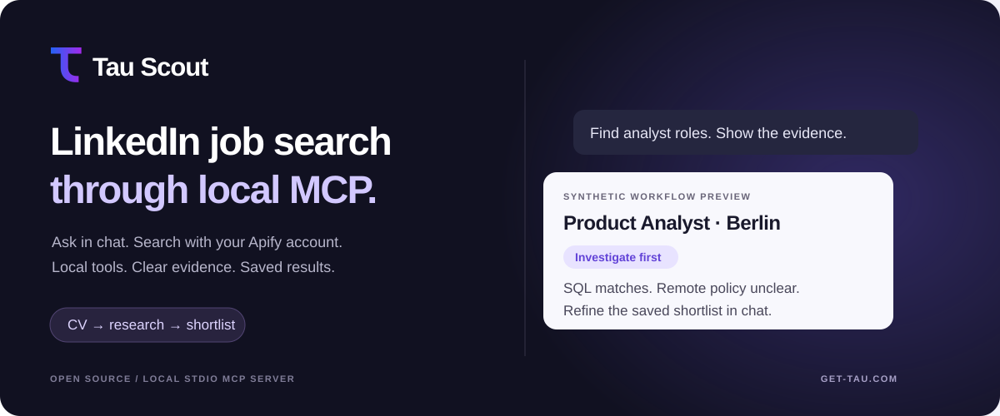

<p align="center">
  <a href="https://get-tau.com"></a>
</p>

<h1 align="center">Tau Scout — LinkedIn Job Search MCP Server</h1>

<p align="center"><strong>Find, compare and refine LinkedIn job shortlists from your AI chat.</strong></p>

<p align="center">
  <a href="LICENSE"></a>
  <a href="pyproject.toml"></a>
  <a href="docs/tool-contract.md"></a>
  <a href="docs/tool-contract.md"></a>
</p>

<p align="center">
  <a href="#first-connection">Connect Scout</a>
  ·
  <a href="#try-it-without-paying">Free demo</a>
  ·
  <a href="#tools-and-scope">MCP tools</a>
  ·
  <a href="https://github.com/ArsenOria/tau-job-research-skills">Add Skills</a>
  ·
  <a href="https://get-tau.com">Explore Tau</a>
</p>

Tau Scout is a local **LinkedIn job search MCP server** for finding and comparing jobs through a conversation with an AI assistant. It connects your AI chat to an Apify jobs source, saves results locally, and helps review skills, experience, student-program eligibility and remote constraints. Bring your own Apify account and token. No Tau server, Tau account, LinkedIn login, or second model API key.

**v0.3 is a developer preview.** The working workflow is MCP-driven; there is no end-user search CLI or dashboard. A compatible local stdio MCP client must launch the installed Python package. Initial installation and secret configuration are setup steps; a one-click installer is not implemented.

## How the LinkedIn job search MCP server works

| Ask in AI chat | Search with Scout | Refine the shortlist |
|---|---|---|
| Supply a role, location and search cap. | Your local MCP server calls Apify using your own token. | Compare CV evidence, experience, student-program requirements and remote constraints. |

The **LinkedIn job shortlist** stays available locally for follow-up review. Live searches use your Apify balance; demo and saved-result refinement need no paid search.

New to this setup? The [LinkedIn job search MCP guide](docs/linkedin-job-search-mcp.md) explains how the chat, local server and Apify token fit together, with a free first check and a bounded live-search example.

## What you say in chat

> Find Product Analyst roles in Berlin from the past week. Use my attached CV to explain which ones fit. Spend no more than $0.50 on this search.

The assistant prepares a plan, explains the source and caps, starts the bounded search, checks the same run, and presents results in chat. Follow up with “Only remote”, “Exclude Example Agency”, or “Explain the first three”. The assistant uses Scout tools; you do not run search commands or move reports between apps.

The companion [**Tau Skills — Job Research Skills for AI Chat**](https://github.com/ArsenOria/tau-job-research-skills) repository contains six individually installable **job research skills for AI chat** to guide this workflow. Scout also works with a capable assistant without installing those skills.

## First connection

Requires Python 3.11+ and an AI client with **local stdio MCP** support. This preview does not provide a remotely hosted MCP URL, and is not directly usable in a chat client that supports only remote connectors.

Clone the repository and install Scout from its directory. If you already checked it out, start with the virtual-environment commands inside that directory. These commands are for one-time setup; ordinary use remains in chat:

```sh
git clone https://github.com/ArsenOria/tau-linkedin-job-research-mcp.git
cd tau-linkedin-job-research-mcp
python3 -m venv .venv
.venv/bin/python -m pip install -e .
```

### Codex desktop

1. Open Codex settings and its MCP servers section. Add a local **STDIO** server named `tau-job-scout`.
2. Set its command to the absolute installed executable path, for example `/ABSOLUTE/PATH/TO/tau-linkedin-job-research-mcp/.venv/bin/tau-job-scout`. No arguments or remote server URL are needed.
3. Add an environment entry named **`APIFY_TOKEN`**, containing your own Apify token. Find/create that token at [Apify Console → Settings → API & Integrations](https://console.apify.com/settings/integrations), as described in [Apify's token documentation](https://docs.apify.com/integrations/api).
4. Save and restart/reconnect the MCP server. Check the active tool list in your chat; restart the desktop app if the connection is not picked up.

Alternatively, merge this block into your **private user-level** `~/.codex/config.toml`, replacing both placeholders locally. Preserve other server entries; if `tau-job-scout` already exists, edit that entry rather than adding it twice:

```toml
[mcp_servers.tau-job-scout]
command = "/ABSOLUTE/PATH/TO/tau-linkedin-job-research-mcp/.venv/bin/tau-job-scout"

[mcp_servers.tau-job-scout.env]
APIFY_TOKEN = "REPLACE_LOCALLY_WITH_YOUR_APIFY_TOKEN"
```

Codex uses TOML here, **not** the `mcpServers` JSON used by some other clients. See [official MCP setup](https://learn.chatgpt.com/docs/extend/mcp?surface=cli) and [configuration reference](https://learn.chatgpt.com/docs/config-file/config-reference). If Codex is already launched with `APIFY_TOKEN` in its process environment, `env_vars = ["APIFY_TOKEN"]` inside the server table can forward it instead of storing the token in the `env` table. A variable exported only in an unrelated terminal is not automatically present in an already-running desktop app.

Install the companion Skills separately: copy the six individual `skills/<name>` folders from the [Tau Skills repository](https://github.com/ArsenOria/tau-job-research-skills#skills) into `~/.agents/skills/`. Each destination should contain its own `SKILL.md` and supporting references. Adding an MCP server does not install those instructions.

### Other local STDIO clients

For clients that accept an `mcpServers` JSON object, the equivalent example is:

```json
{
  "mcpServers": {
    "tau-job-scout": {
      "command": "/ABSOLUTE/PATH/TO/tau-linkedin-job-research-mcp/.venv/bin/tau-job-scout",
      "env": {
        "APIFY_TOKEN": "REPLACE_LOCALLY_WITH_YOUR_APIFY_TOKEN"
      }
    }
  }
}
```

The exact settings screen and config shape depend on your MCP client; the example illustrates the server process. Put `APIFY_TOKEN` in the client's secret/process-environment settings, using the token from **your own** Apify account. If the client stores environment values in a config file, protect that file and never commit or share it. Do not paste a token into the AI conversation. Scout does not read `.env` files automatically.

Reconnect the server after changing environment settings. Ask “Check Scout's connection” to inspect `get_scout_status`: it returns only whether a token is configured, not the token. This local check does not validate the token against Apify. Demo/import work with no token.

### First check in chat

> Check Scout's connection and token presence without revealing the token. Do not start a search or make paid requests.

Expected: `get_scout_status` is available and returns `apify_configured: true` (or false if the token is not set). If there are no Scout tools, check the executable path and restart the server. If token presence is false, check the MCP server environment and reconnect. A `.env` file by itself is insufficient. Do not run the STDIO executable directly to search: the AI client starts it and handles the protocol.

Once the free check passes, use the demo below. For a real search, ask for a small run, for example five roles with a $0.10 cap; token/credit errors can only be confirmed when Apify is contacted. The assistant will show the proposed query and limits before starting.

## Try it without paying

Ask: **“Use Scout's synthetic demo to show me Product Analyst roles in Berlin and compare SQL and Python relevance. Do not make paid requests.”**

The assistant calls `prepare_search` with `source: "demo"`, then uses `search_jobs`, `rank_jobs` and `refine_shortlist`. Every demo result is labeled synthetic. Demo data illustrates the workflow rather than matching every requested filter, and its links must not be used as real application links.

## Tools and scope

| Tool | Purpose |
|---|---|
| `get_scout_status` | Local capabilities and token-presence check |
| `prepare_search` | Validate and persist a bounded plan; no paid call |
| `search_jobs` | Start or reuse one Apify/demo search per plan |
| `get_search_status` | Poll an existing run once, save bounded results |
| `get_saved_results` | Read saved results without another search |
| `rank_jobs` | Normalized skills, relevant student programmes and evidenced experience/education/remote checks |
| `refine_shortlist` | Filter saved fields; optionally rank again |
| `import_jobs` | Save structured job data from the conversation |

See [the exact tool contract](docs/tool-contract.md), [data flow](docs/data-flow.md), [Apify adapter notes](docs/apify-setup.md), and [the final implementation plan in Russian](PLAN_RU.md).

The [Scout 0.2 before/after replay in Russian](docs/BEFORE_AFTER_RU.md) includes all thirty profile/job comparisons in JSON and the v0.2 constraint-aware results; it is historical evidence, not a v0.3 evaluation.

The [installed-module and output-quality assessment](docs/OUTPUT_QUALITY.md) compares raw Scout results with native Codex/Skills judgments for three synthetic profiles. It documents current ranking and source-data limitations rather than treating a passing API test as proof of recommendation quality.

## Matching and uncertainty

The host assistant reads your attached CV and proposes a minimal candidate profile. Scout does not read arbitrary local files or send a CV to Apify. No extra LLM key is required: the AI chat provides deeper reasoning, and Scout supplies an explicit deterministic baseline.

Version 0.3 retains the separation of normalized title/skill `heuristic_score` from constraint-adjusted `ranking_score`, recommendations and source evidence, and adds student-program affinity and education/placement eligibility checks. Supply explicit experience years, target seniority, remote working country and known experience domains when available. Known conflicts sort last; preferred expectations and absent facts do not become hard exclusions. A/B wording variants and common tool aliases are normalized without treating NoSQL as SQL.

Saved descriptions can support effective workplace, remote geography, experience requirements and employer/publisher distinctions, with quoted provenance. Legacy rows are enriched at read time without another paid search. Employer identity remains a source claim; remote format/timezone does not establish legal work authorization. Scores are not interview probabilities, and an observed listing is not a guarantee it remains open. Publication time and observation time are separate. `research.publication` labels provider/import dates as unverified claims; a fresh collection, repost or recency filter does not prove a new original publication. A legacy snapshot cannot recover an employer date without separate evidence. `research.employer` keeps publishers, recruiters and named clients distinct; an unnamed client does not become a guessed employer.

For student searches, provide evidenced `is_student`, `degree_completed`, `graduation_year` and `fields_of_study`; optionally supply `placement_year_available`, `completed_study_years` and `grade_classification` when known. A relevant placement can rank above a generic analyst role while still requiring verification of study/grade/sponsorship conditions. Academic projects are not commercial employment, and a start year is not a graduation cohort.

## Costs, privacy and limitations

- Apify charges **your account**. Default cap: 25 results and $0.50 per prepared run; hard limits: 100 results and $5.00. A cap is not a quote or a guarantee of useful results. No scheduler or automatic paid retry exists.
- `search_jobs` persists a reservation before its paid POST. The same `plan_id` cannot create a second run, including concurrent calls and process restarts. `start_uncertain` means a run may exist: inspect your Apify Console before asking for a new search. A fresh plan represents a new potentially paid operation.
- State is local SQLite under `~/.local/share/tau-job-scout`, in a private directory. Override the directory with an absolute `TAU_SCOUT_DATA_DIR`. There is no telemetry or Tau backend. The AI client and Apify have their own data handling; see [data flow](docs/data-flow.md).
- Only `bebity/linkedin-jobs-scraper` is supported. Actor APIs, result formats, availability and prices can change. A [bounded live MCP check](docs/LIVE_TEST.md) on 2026-11-11 saved five real listings after fixing regional URL handling; the reported run usage was $0.0056. This is one smoke test, not a coverage or reliability guarantee.
- Apify is a third-party scraper platform, not official LinkedIn authorization. LinkedIn restricts automated access and scraping in [its User Agreement, section 8.2](https://www.linkedin.com/legal/user-agreement). Import/demo remain available when the source is unavailable.
- Scout cannot log into LinkedIn, apply, send messages, research hiring posts, or enrich companies. Company research uses the host assistant's available web tools. Company headcount and other unsupported filters are not silently guessed.

## Development

```sh
.venv/bin/python -m pip install -e '.[dev]'
.venv/bin/python -m pytest -q
.venv/bin/python -m build
```

Tests use synthetic data, fake HTTP transports, and the real MCP SDK stdio transport. They do not need real credentials or make paid Apify/LinkedIn calls. See [contributing](CONTRIBUTING.md). Licensed under [MIT](LICENSE).
